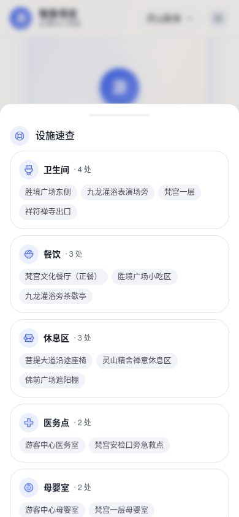
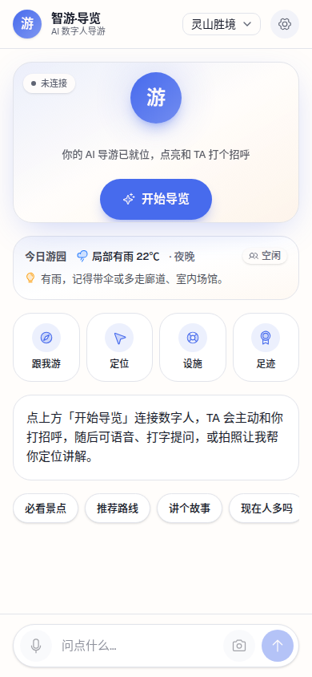

# 途叨叨 · 景区导览服务 AI 数字人系统

> 第十五届中国软件杯大赛 · A 组作品

途叨叨是一套面向景区游客的 AI 数字人导览系统：游客可以通过手机或大屏访问景区导览页，用自然语言提问、语音输入或拍照识别获取景点信息；系统结合 RAG 知识库、实时数字人、地图路线与个性化足迹，把“查资料”变成一段可互动的游览体验。


## 作品亮点

- **AI 景区问答**：基于景区知识库进行检索增强问答，支持文字、语音和图片输入。
- **实时数字人**：通过 LiveTalking / Ditto 驱动数字人播报，支持横屏游客端与竖屏大屏端。
- **景区服务闭环**：景点推荐、地图路线、设施导航、到达打卡、足迹与勋章、明信片分享。
- **单入口访问**：桥接层统一托管前端并反向代理问答、数字人和媒体流服务，适合公网部署。
- **云端/本地双模式**：问答后端可运行在 CPU 云主机，数字人渲染节点按需使用 GPU。

## 系统架构

```text
浏览器 / 手机游客端
          │
          ▼
桥接层 bridge（前端托管 · API 反代 · FLV 媒体流）
       ┌──┼──────────────┐
       ▼  ▼              ▼
   RAG 后端  LiveTalking / Ditto       SRS
   问答检索  实时口型与表情驱动       RTMP → FLV
```

## 界面预览

| 游客端导览 | 景区信息与服务 | 数字人舞台 |
|---|---|---|
|  |  |  |

本仓库是**可审查、可迁移的源码包**，不是包含全部模型权重和运行数据的整机镜像。完整部署边界、资源清单和服务器运行链路请继续阅读下文；首次复现建议从 [`digital_person/docs/部署手册.md`](digital_person/docs/部署手册.md) 开始。

## 一、源码包概述

本包收录复现系统主要功能所需的**业务源代码、前后端工程、数字人接口改动、部署配置、启动脚本与环境导出记录**。

源码包总体积约 **264 MB**。其中较大的部分主要是产品展示图、数字人形象设计素材、景区公开资料和设计文档；不包含 `node_modules`、Python 虚拟环境、模型权重、TensorRT Engine、运行数据库、Chroma 向量库和 LiveTalking 头像运行素材。

这些大文件建议作为**运行资源包**单独提交或按赛事要求另行说明。原因如下：

| 类型 | 是否在本源码包内 | 说明 |
|---|---:|---|
| 业务源代码 | 是 | 主系统、管理端、游客端、数字人桥接与启动脚本均已包含 |
| 前端源码 | 是 | `digital_person/webapp` 与 `admin/frontend` 保留源码和依赖清单 |
| 前端构建产物 `dist` | 否 | 可由源码重新构建，避免混入历史构建结果 |
| 知识库源资料 | 部分包含 | `digital_person/knowledge_base` 与 `示范景区公开资料包` 保留轻量资料 |
| Chroma 向量库 | 否 | 属于运行数据，可由知识库重建 |
| LiveTalking 头像运行素材 | 否 | 体积较大，适合进入运行资源包 |
| Ditto/数字人模型权重 | 否 | 体积大，且部分 TensorRT 产物与 GPU 架构绑定 |
| 真实 API Key、`.env`、SSH 密钥 | 否 | 出于安全考虑全部排除或脱敏 |

## 二、目录结构

| 目录 | 内容 |
|---|---|
| `digital_person/` | 主系统：RAG 问答后端、桥接层、游客端 Web 工程、项目脚本、展示素材与文档 |
| `admin/` | 管理端：FastAPI 后端、Vue 前端源码、管理端部署脚本 |
| `engine/` | 数字人相关工程：LiveTalking 源码、推流辅助代码、Ditto 配置记录 |
| `ops/` | 服务器当前使用的 Supervisor、SRS 配置、启停脚本和数字人启动脚本 |
| `environment/` | 服务器 Python 版本、`pip freeze` 与系统/GPU 环境记录 |
| `documentation/git_records/` | 各代码仓库的 commit、remote、status 和未提交 diff 记录 |
| `FILE_MANIFEST.txt` | 当前源码包文件清单 |
| `THIRD_PARTY.md` | 第三方组件说明 |
| `POSSIBLE_SECRET_FILES.txt` | 敏感关键词扫描命中文件列表，已用于人工复查 |

`digital_person/` 目录内的关键内容：

| 路径 | 说明 |
|---|---|
| `backend/` | 主 RAG/问答/推荐/知识库接口服务代码 |
| `bridge/` | 对游客端和数字人服务暴露的桥接服务，是线上访问链路的重要入口 |
| `webapp/` | 游客端 Web 前端源码 |
| `livetalking_engine/` | 主系统内维护的数字人接口适配代码 |
| `assets/` | 展示图、头像设计图、景区背景图、技术栈图等素材 |
| `knowledge_base/` | 轻量知识库源资料 |
| `示范景区公开资料包/` | 景区公开资料与游客行为示例数据 |
| `scripts/` | 数据处理、素材生成、部署辅助和实验脚本 |
| `docs/`、`delivery/` | 设计文档、部署记录和交付材料 |

## 三、当前服务器运行链路

根据服务器当前 `supervisord.conf`，线上服务主要由以下组件组成：

| 服务 | 工作目录 | 说明 |
|---|---|---|
| `rag` | `/root/autodl-tmp/Digital_Person` | 主系统后端，运行 `backend.main:app`，端口 `8000` |
| `bridge` | `/root/autodl-tmp/Digital_Person` | 桥接层，运行 `bridge.server:app`，端口 `6006` |
| `admin_api` | `/root/digital-human/backend` | 管理端后端，端口 `6008` |
| `livetalking_main` | `/root/autodl-tmp/LiveTalking` | 横版数字人服务，由 `ops/lt_run.sh` 对应脚本启动 |
| `livetalking_portrait` | `/root/autodl-tmp/LiveTalking` | 竖版数字人服务，由 `ops/lt_run_portrait.sh` 对应脚本启动 |
| `srs` | `/root/autodl-tmp/srs/trunk` | RTMP/WebRTC 流媒体服务，本包仅保留相关配置 |
| `relay_hz`、`tunnel_hz` | `/root/autodl-tmp` | 中继与反向隧道相关进程 |

本源码包保留了上述链路涉及的业务代码和配置，但未复制完整 `/root/autodl-tmp`，避免带入模型权重、日志、视频、缓存、数据库、虚拟环境、密钥和第三方编译目录。

## 四、与旧版源码包的差异

旧版源码包中包含独立的 `kiosk/` 目录、部分前端 `dist`、`vector_store/` 和数字人底板等资源。本次服务器最新代码整理后有以下变化：

| 项目 | 当前处理 |
|---|---|
| 独立 `kiosk/` 源码 | 服务器未发现独立源码目录，仅发现历史 `kiosk_dist.tgz` 和相关脚本，因此本包不再单列 `kiosk/` |
| 游客端前端 | 以 `digital_person/webapp/` 为准 |
| 管理端前端 | 以 `admin/frontend/` 为准 |
| 前端 `dist` | 已排除，提交源码与 `package.json`，需要时重新构建 |
| `vector_store/` | 已排除，作为运行数据/资源包处理 |
| LiveTalking `data/ditto_avatars` | 已排除，约数百 MB，作为运行资源包处理 |
| SRS | 不提交完整第三方编译目录，仅保留 `ops/srs_config/` 中的配置 |
| Git 记录 | 新增 `documentation/git_records/`，用于说明当前代码基线和未提交改动 |

## 五、使用前的三点说明

**1. 需自行配置 API Key。**  
系统的大模型、向量嵌入、语音合成、图像生成等能力依赖外部云服务。源码包不包含真实 Key；运行前应通过 `.env` 或系统环境变量配置，例如：

```bash
export DASHSCOPE_API_KEY="your_api_key_here"
```

`ops/lt_run.sh` 和 `ops/lt_run_portrait.sh` 的提交副本已改为检查环境变量，不再写死真实 Key。

**2. 大文件资源需要单独准备。**  
若只审查源码，本包已足够。若要求完整复现服务器运行效果，还需要另行准备：

| 资源 | 典型位置 | 说明 |
|---|---|---|
| Ditto 模型权重与 TensorRT Engine | `ditto-talkinghead/checkpoints/` | TensorRT Engine 通常需要在目标 GPU 上重新编译 |
| LiveTalking 头像运行素材 | `LiveTalking/data/ditto_avatars/` | 当前线上横版/竖版数字人依赖该目录 |
| Chroma 向量库 | `Digital_Person/vector_store/` | 可作为资源包提交，也可从知识库源资料重建 |
| 运行数据库 | 管理端或主系统数据库路径 | 建议提交脱敏示例库或建表/初始化脚本，不直接提交生产库 |

**3. 部署脚本来自当前服务器。**  
`ops/` 中保留了服务器正在使用或历史保留的启动脚本。由于本包是“源码包”而不是“整机镜像”，脚本中的 `/root/autodl-tmp`、`/root/digital-human`、`/root/miniconda3` 等路径反映服务器当前部署方式；迁移到新机器时需要按部署手册或实际路径调整。

## 六、环境与依赖

依赖信息已导出在 `environment/`：

| 文件 | 说明 |
|---|---|
| `main_python_version.txt` | 主系统 Python 版本 |
| `main_requirements_freeze.txt` | 主系统服务器环境 `pip freeze` |
| `admin_python_version.txt` | 管理端 Python 版本 |
| `admin_requirements_freeze.txt` | 管理端服务器环境 `pip freeze` |
| `system_environment.txt` | 服务器系统、GPU、驱动信息 |

源码内也保留了项目级依赖文件：

| 路径 | 说明 |
|---|---|
| `digital_person/requirements.txt` | 主系统基础依赖 |
| `digital_person/requirements.cloud.txt` | 云端部署相关依赖 |
| `admin/backend/requirements.txt` | 管理端后端依赖 |
| `engine/LiveTalking/requirements.txt` | LiveTalking 依赖 |
| `digital_person/webapp/package.json` | 游客端前端依赖与脚本 |
| `admin/frontend/package.json` | 管理端前端依赖与脚本 |

`pip freeze` 是服务器实况导出，可能包含比最小运行集更多的包；正式部署时建议优先参考各子项目的 `requirements.txt`，再结合 `environment/` 排查版本差异。

## 七、快速开始

以下步骤用于在新机器上按源码包检查和准备工程，不等同于完整 GPU 数字人部署。

```bash
cd 作品源码_服务器更新_20260730_230226_完整

# 主系统后端依赖
cd digital_person
python -m venv .venv
source .venv/bin/activate
pip install -r requirements.txt

# 游客端前端
cd webapp
npm install
npm run build

# 管理端前端
cd ../../admin/frontend
npm install
npm run build
```

服务器原始运行方式可参考：

```bash
cd ops
bash start_all.sh
```

但该脚本面向原服务器路径，迁移部署前应先确认模型权重、LiveTalking 头像素材、SRS、Conda 环境和端口配置已经就绪。

## 八、提交包清理说明

本次整理已执行以下清理：

| 清理项 | 结果 |
|---|---|
| `.git/`、`.github/`、IDE 配置 | 已排除 |
| `node_modules/`、`venv/`、`.venv/` | 已排除 |
| `dist/`、`build/`、CMake 编译产物 | 已排除 |
| `__pycache__/`、`.pytest_cache/` 等缓存 | 已排除 |
| `.env*`、`*.pem`、`*.key`、SSH 私钥 | 已排除 |
| 日志、pid、sock、临时目录 | 已排除 |
| 模型权重、ONNX、TensorRT Engine | 已排除 |
| SQLite/DB 文件 | 已排除 |
| 大体积视频/音频文件 | 已排除 |
| Markdown 中残留的 `sk-...` token | 已脱敏 |

本地复查结果：

```text
源码目录大小：264M
文件数量：1089
未发现 node_modules / venv / .git / __pycache__
未发现 .env / pem / key / id_rsa / id_ed25519
未发现 sk-... 形式明文 token
```

## 九、建议提交方式

若比赛系统要求提交源码文件夹，建议提交当前目录：

```text
作品源码_服务器更新_20260730_230226_完整/
```

若比赛系统要求压缩包，建议使用同目录下已校验的压缩包：

```text
tudaodao_source_clean_20260730_230226.tar.gz
```

压缩包 SHA256 以同目录下的校验文件为准：

```text
tudaodao_source_clean_20260730_230226.tar.gz.sha256
```

若赛事后续明确要求“完整可运行环境”，请不要把服务器 `/root/autodl-tmp` 整体打包；应另做运行资源包，只补充模型权重、头像运行素材、向量库和脱敏数据库。
