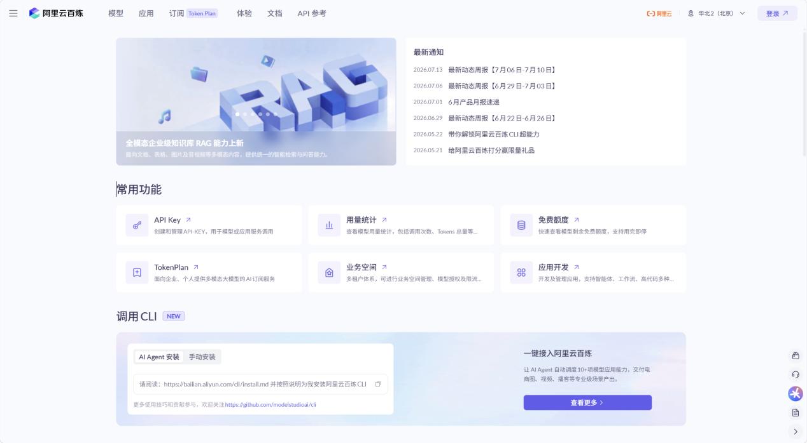
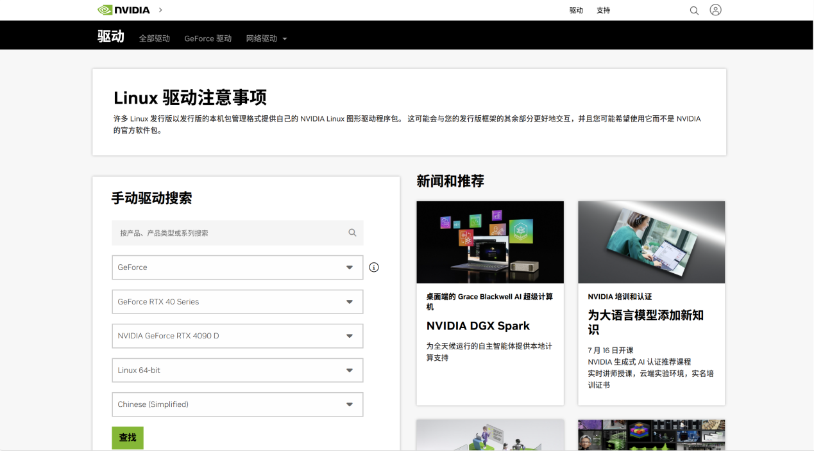
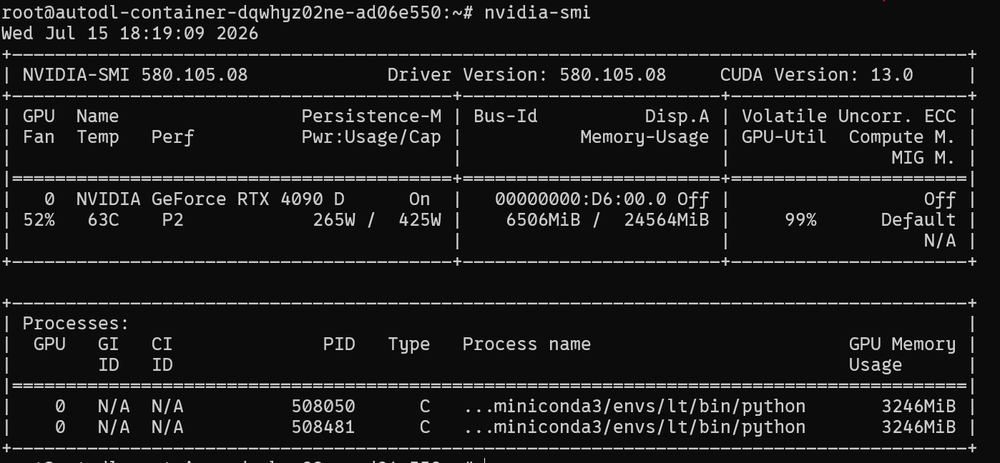
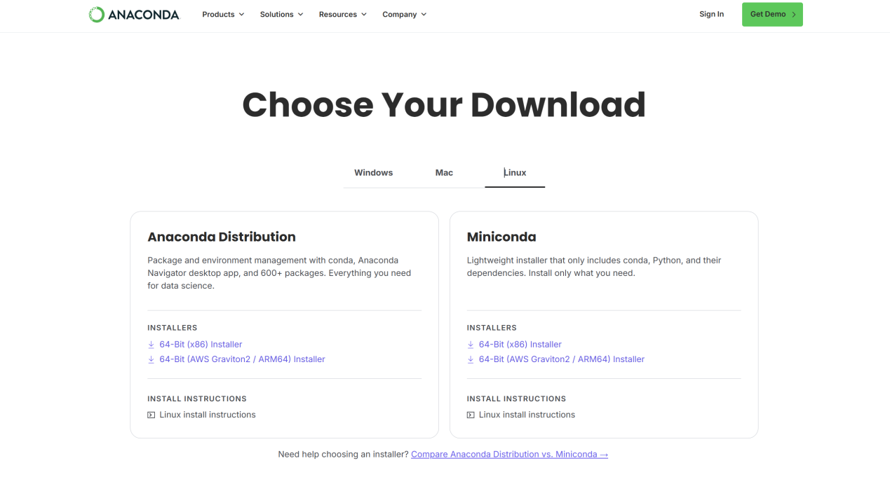
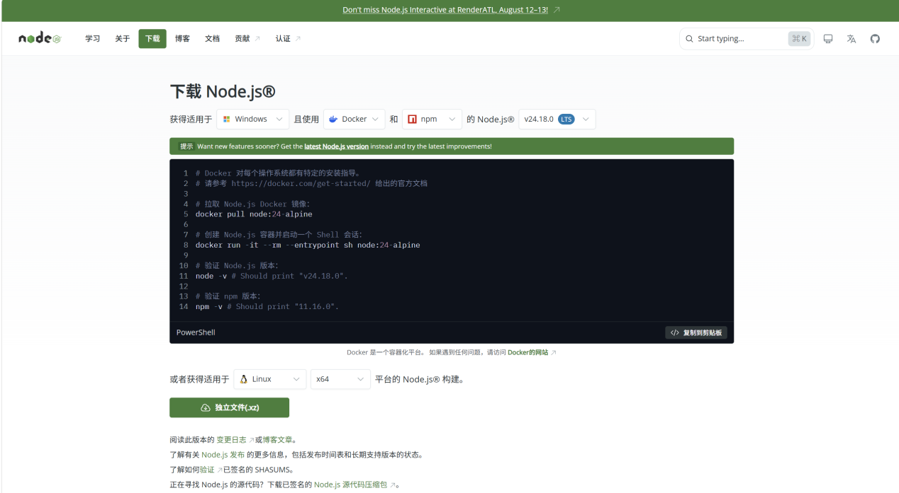

# 景区导览服务 AI 数字人 · 部署手册

## 1. 手册说明

### 1.1 编写目的与配套交付物

本手册面向首次接触本系统的部署者，配合源码包 `作品源码/`，从一台干净的机器开始把系统部署起来。

**本手册只讲「怎么装起来」**，系统装好后的功能操作说明见另一份《使用手册》。

| 交付物 | 位置 | 说明 |
|---|---|---|
| 源码包 | `作品源码/` | 全部源代码、配置、脚本，以及已入库的向量库、数字人底板、三个前端的构建产物 |
| 部署手册 | 本文件 | 从零开始的部署步骤 |
| 使用手册 | 另行交付 | 游客端与管理端的功能操作说明 |

源码包内**已经预先完成**的工作，因此部署时无需再做：

- 三个前端（游客端手机网页、管理端、大屏）**均已构建完毕** → 不必安装 Node.js、不必执行 `npm install`
- 8 个景区的向量库**已完成入库** → 部署完即可问答，不必等待入库
- 部署过程由 `deploy.sh` 一条命令完成 → 装依赖、起服务、体检、打印访问地址

源码包**不含**模型权重、Python 虚拟环境与 TensorRT 引擎（合计约 10 GB）。其中 TensorRT 引擎与 GPU 架构绑定，**必须在部署机本地编译**，复制无效；获取与编译由档位 B 的脚本自动完成。

### 1.2 三种部署档位

本系统按算力需求解耦：问答、检索、分析、管理等逻辑服务是**纯 CPU 负载**，只有数字人实时渲染需要 GPU。因此可按需选择：

| 档位 | 能体验到 | GPU | 预计耗时 |
|---|---|---|---|
| **A · 逻辑后端** | 智能问答（含赛题准确率红线项）、知识库管理、管理端、数据大屏、游客端手机网页与大屏页面 | **不需要** | 约 30 分钟 |
| **B · 数字人全栈** | 档位 A + **数字人实时说话**（语音 / 口型 / 表情） | 需要，显存 ≥ 4 GB | 档位 A + 2~3 小时 |
| **C · 公网访问** | 档位 B + 手机扫码即用的公网入口 | 同 B | 档位 B + 约 1 小时 |

**仅验证系统功能与准确率指标，档位 A 即可。**

---

## 2. 运行环境

### 2.1 硬件环境

本系统已在以下两套真实硬件上完成部署与端到端验证：

| 项 | 本地演示机 | 云端公网机 |
|---|---|---|
| 机型 | ROG 幻16 笔记本 | AutoDL 云实例 |
| GPU | RTX 4080 Laptop，11.6 GB | RTX 4090 D，24 GB |
| 驱动 | 580.159.03 | 580.105.08 |
| CPU / 内存 | — | 128 核 / 503 GB |
| 操作系统 | Ubuntu 22.04 | Ubuntu 22.04.5 LTS |

复刻本系统所需的**最低配置**：

| 角色 | 最低 | 推荐 |
|---|---|---|
| 档位 A 节点 | 2 核 / 4 GB 内存 / 20 GB 硬盘 / **无需 GPU** | 4 核 / 8 GB |
| 档位 B 节点 | 显存 ≥ 4 GB 且计算能力 sm_80 以上（RTX 30/40 系）/ 60 GB 硬盘 | 显存 ≥ 12 GB |
| 操作系统 | Ubuntu 20.04 及以上 | Ubuntu 22.04 |
| 网络 | 可访问阿里云百炼 API | 同左 |

各服务实测显存占用：

| 服务 | 显存 | 说明 |
|---|---|---|
| RAG 问答后端 | **0** | `DEPLOY_MODE=cloud`，向量嵌入走云端 |
| 语音识别 ASR | **0** | faster-whisper small，CPU int8 |
| 数字人渲染（Ditto） | **2.7 GB / 路** | TensorRT 实时全脸驱动 |
| 媒体服务器 / 桥接层 | **0** | 纯 CPU |

### 2.2 软件依赖

**档位 A 所需**（`deploy.sh` 自动安装，此处仅列明版本基线）：

| 依赖名 | 版本 | 用途 |
|---|---|---|
| Python | 3.10 及以上（实测 3.10 / 3.11 / 3.12） | 后端运行时 |
| fastapi | ≥ 0.111 | Web 框架 |
| uvicorn | ≥ 0.30 | ASGI 服务器 |
| chromadb | ≥ 0.5 | 向量数据库 |
| dashscope | ≥ 1.20 | 阿里云百炼 SDK |
| rank_bm25 | ≥ 0.2.2 | 稀疏检索 |
| pandas / openpyxl | ≥ 2.0 / ≥ 3.1 | 行为数据分析 |
| python-docx / pymupdf | ≥ 1.1 | 知识库文档解析 |

**档位 B 额外所需**（由 `ops/` 下脚本自动安装）：

| 依赖名 | 版本 | 用途 |
|---|---|---|
| PyTorch | 2.4.1+cu124 | Ditto 引擎依赖 |
| TensorRT | 8.6.1 | 数字人实时推理后端 |
| cuDNN | 8.9.7.29 | TRT 8.6.1 依赖，独立目录注入 |
| CUDA | 12.4（torch 侧） | 同上 |
| SRS 媒体服务器 | 5.0.224 | RTMP → HTTP-FLV |
| ffmpeg | 4.4 及以上 | 推流中继与音频检测 |

**云端大模型服务**（全部走阿里云百炼，无需本地部署）：

| 模型 | 用途 |
|---|---|
| qwen-plus / qwen-flash | 事实问答 / 路线推荐等生成性意图 |
| qwen3-vl-plus | 多模态视觉定位 |
| text-embedding-v3 | 向量嵌入 |
| Qwen-TTS | 语音合成 |

---

## 3. 部署说明

### 3.1 准备：申请 API Key

本系统的文本大模型、多模态大模型、向量嵌入、语音合成全部走阿里云百炼。**这是整个部署过程中唯一需要从外部获取的东西。**

1. 打开百炼控制台 <https://bailian.console.aliyun.com/>，用阿里云账号登录
2. 开通「模型百炼服务」（新用户有免费额度）
3. 进入 **API-KEY 管理**，创建 API Key，形如 `sk-xxxxxxxx`

{width=5.767in}

### 3.2 档位 A：逻辑后端（无需 GPU，约 30 分钟）

**四条命令即可完成。**

**步骤 1** 安装 Python（Ubuntu / Debian；已有 Python 3.10+ 可跳过）

```bash
sudo apt update && sudo apt install -y python3 python3-venv python3-pip
```

> ⚠️ `python3-venv` 必须装。只装 `python3` 不够——创建虚拟环境所依赖的 `ensurepip` 在这个单独的包里，缺了会报 `ensurepip is not available`。（`deploy.sh` 检测到缺失且以 root 运行时会尝试自动安装。）

**步骤 2** 解压源码包

```bash
unzip 作品源码.zip
cd 作品源码
```

**步骤 3** 填入 API Key

```bash
cp digital_person/.env.example digital_person/.env
# 编辑该文件，把 DASHSCOPE_API_KEY= 后面换成步骤 3.1 申请的真实 Key
vim digital_person/.env
```

**步骤 4** 一键部署

```bash
bash deploy.sh
```

该脚本依次完成：创建虚拟环境 → 安装依赖 → 校验 API Key → 按依赖顺序拉起 RAG 后端、管理端后端、桥接层 → 逐项健康检查 → 打印访问地址。任一步失败会打印该服务的日志尾部与排查提示。

成功后终端会输出：

```
✅ 档位 A 全部就绪（4 项检查通过）

【浏览器打开这些地址】
  游客端手机网页    http://<部署机IP>:6006/
  管理端后台        http://<部署机IP>:6006/admin
  数据大屏          管理端登录后 → 左侧「投放」→ 数据大屏
```

**停止服务**：`bash ops/stop_a.sh`

至此档位 A 完成。系统的问答、知识库管理、管理端、数据大屏、游客端手机网页与大屏页面均已可用，仅数字人画面区域为未连接状态。可直接跳到第 4 章验证。

> **说明**：桥接层（6006）是系统的**唯一对外入口**，同源提供三个前端并反代后端接口，因此对外只需开放这一个端口。RAG（8000）与管理端（6008）只监听本机。
>
> 端口被占用时，可在 `ops/env.local.sh` 中写 `export BRIDGE_PORT=你的端口` 等覆盖，无需改动任何脚本。

### 3.3 档位 B：数字人全栈（需要 GPU）

在档位 A 已跑通的基础上进行。

**步骤 1** 安装 NVIDIA 驱动（建议 ≥ 550），并验证

```bash
nvidia-smi
```

驱动从 <https://www.nvidia.cn/drivers/lookup/> 按显卡型号查询下载。

{width=5.767in}

`nvidia-smi` 应能看到显卡型号、驱动版本与显存：

{width=5.767in}

**步骤 2** 安装 Miniconda（数字人引擎需要独立的 Python 3.10 环境）

从 <https://www.anaconda.com/download/success> 下载，或直接命令行安装：

{width=5.767in}

```bash
wget https://repo.anaconda.com/miniconda/Miniconda3-latest-Linux-x86_64.sh
bash Miniconda3-latest-Linux-x86_64.sh
```

**步骤 3** 建立数字人专用环境并安装依赖

```bash
conda create -n lt python=3.10 -y && conda activate lt
pip install torch==2.4.1 torchvision --index-url https://mirror.sjtu.edu.cn/pytorch-wheels/cu124
pip install tensorrt==8.6.1 --no-build-isolation
pip install cuda-python==12.4.0 polygraphy nvidia-cudnn-cu11==8.9.7.29
```

> ⚠️ 三个必踩的坑：`tensorrt` 是源码 meta 包，不加 `--no-build-isolation` 会因拉不到 setuptools 而失败；TensorRT 8.6.1 **在 Python 3.12 上装不上**，所以这个环境必须是 3.10；torch 大轮子走官方源极慢，用上面的 SJTU 镜像实测可达 10 MB/s。

**步骤 4** 拉取引擎仓库并打上本系统的改动

```bash
cd ..                       # 回到源码包的上一级目录
git clone https://github.com/antgroup/ditto-talkinghead.git
git clone https://github.com/lipku/LiveTalking.git
cd ditto-talkinghead && git apply ../作品源码/engine/ditto-talkinghead.patch && cd ..
cp -r 作品源码/digital_person/livetalking_engine/* LiveTalking/
cp -r 作品源码/engine/ditto_cfg ditto-talkinghead/checkpoints/
```

> ⚠️ 源码包内还有一份 `engine/LiveTalking.patch`，**不要整包 `git apply`**。该仓库当初是 shallow clone，工作区混入了早于克隆时间的上游文件，整包应用会回退掉上游的 SenseVoice ASR 功能。请以 `livetalking_engine/` 目录内的文件为准逐个覆盖（即上面的 `cp -r`），逐文件对应关系见 `engine/README.md`。

**步骤 5** 编译 TensorRT 引擎（一次性，约 20~40 分钟）

```bash
bash 作品源码/ops/build_trt_ada.sh
```

脚本会自动下载 Ditto 的 ONNX 权重（约 2.4 GB）并编译成**本机 GPU 架构**的 TensorRT 引擎。TRT 引擎与显卡架构绑定，这一步无法跳过、也不能复制他人的产物。

**步骤 6** 放置数字人底板

```bash
mkdir -p LiveTalking/data/ditto_avatars
cp 作品源码/digital_person/avatar_plates/*.png LiveTalking/data/ditto_avatars/
```

> ⚠️ **这四张必须用包内的，不要自行重新合成。** Ditto 的形象就是一张源肖像 PNG（`--avatar_id X` 直接对应 `data/ditto_avatars/X.png`，没有预处理目录、没有 pkl）。背景图里只要含有人形或面孔剪影，就会毒化 Ditto 的源图处理，导致数字人嘴唇坍缩成一条线、全程张不开——这是本系统实际踩过并定位的问题。

**步骤 7** 编译 RTMP 推流绑定

```bash
cd python_rtmpstream 2>/dev/null || git clone https://gitee.com/lipku/python_rtmpstream.git && cd python_rtmpstream
git submodule update --init && cd python
pip install .
cd ../..
```

> ⚠️ cmake 报 `Could not find pybind11` 时，加 `-Dpybind11_DIR=$(python -m pybind11 --cmakedir)`。

**步骤 8** 启动媒体服务器与数字人

SRS 媒体服务器直接用官方镜像，无需编译：

```bash
docker run -d --name srs --network host \
  -v $PWD/作品源码/ops/srs_dp.conf:/usr/local/srs/conf/srs.conf \
  ossrs/srs:5 ./objs/srs -c conf/srs.conf
```

> 不便使用 Docker 时，也可从源码编译 SRS 5.0（`git clone -b 5.0release https://github.com/ossrs/srs.git`），配置文件同样用 `ops/srs_dp.conf`。

然后拉起全栈：

```bash
bash 作品源码/ops/dp_up.sh        # 拉起数字人两路 + 桥接 + RAG（两路数字人各约 85 秒出流）
bash 作品源码/ops/preflight.sh    # 体检
```

浏览器打开 `http://<部署机IP>:6006/`，数字人画面即会出现。

> ⚠️ 体检建议带 `--audio` 跑一次。数字人「不出声」这类故障只看日志发现不了，必须用 ffmpeg 实测音频电平。

### 3.4 档位 C：公网访问（可选）

公网形态用 supervisor 守护全部服务，经云平台的 HTTP 代理对外。要点：

- 浏览器拉直播流的端点必须与前端**同源**，落在桥接层端口上（桥接的 `/stream.flv` 反代 SRS 内部 FLV）
- 用 HTTP-FLV 而非 HLS：HLS 分段缓冲会额外增加 1~3 秒延迟，会顶破 5 秒的语音问答目标
- 云平台若只开放少数端口，把桥接层监听在被映射的那个端口上即可
- ⚠️ **手机端要用麦克风必须走 HTTPS**（浏览器安全策略限制 `getUserMedia`）。局域网 http 访问时语音输入不可用，文字与拍照不受影响

守护配置见 `ops/supervisord.conf`（档位 A 精简版为 `ops/supervisord.a.conf`），公网相关变量在 `ops/env.local.sh` 中配置。

---

## 4. 验证清单

按顺序验，每步都能独立判断成败。

| # | 验证项 | 命令 / 操作 | 期望结果 |
|---|---|---|---|
| 1 | 路径与环境 | `bash ops/env.sh` | 各变量显示 `[OK]` |
| 2 | RAG 后端 | `curl http://127.0.0.1:8000/health` | `{"status":"ok"}` |
| 3 | 桥接层 | `curl http://127.0.0.1:6006/live/health` | 返回 JSON |
| 4 | **智能问答** | `curl -X POST http://127.0.0.1:6006/rag/chat -H 'Content-Type: application/json' -d '{"session_id":"t","message":"灵山大佛有多高","scenic_id":"lingshan"}'` | 回复含「88 米」 |
| 5 | **插拔式知识库** | 同上，把 `scenic_id` 换成 `gugong`、问题换成「故宫有多少间房」 | 回复含「9000 余间」 |
| 6 | **准确率红线 ≥90%** | `cd digital_person && DEPLOY_MODE=cloud .venv/bin/python tests/test_accuracy.py lingshan` | 命中率 ≥ 90% |
| 7 | 游客端手机网页 | 浏览器打开 `http://<IP>:6006/` | 页面正常，可问答 |
| 8 | 管理端 | 打开 `http://<IP>:6006/admin`，点「注册」建账号 | 知识库管理、数据大屏可用 |
| 9 | 大屏端 | 打开 `http://<IP>:6006/kiosk/` | 页面正常 |
| 10 | 知识库重建（可选） | `DEPLOY_MODE=cloud .venv/bin/python scripts/ingest_all.py --list` | 列出 8 个景区及其源文档 |
| 11 | 数字人（档位 B） | 打开 `http://<IP>:6006/`，提问 | 数字人开口说话，口型同步 |

以上全绿即部署完成。系统各项功能怎么用，见另一份《使用手册》。

> 关于第 10 项：源码包已附带 8 个景区的向量库，**开箱即用**。若想亲自验证「插拔式知识库、换库不换码」的设计，可执行 `DEPLOY_MODE=cloud .venv/bin/python scripts/ingest_all.py` 从原始 docx 重建全部 8 个景区；每个景区先清空再重建，可重复执行、结果幂等。

---

## 5. 常见问题排查

按出现频率排序。

**部署期**

- **`ensurepip is not available` / 创建虚拟环境失败** → 缺 `python3-venv` 包。`sudo apt install -y python3-venv` 后重跑 `bash deploy.sh`。
- **pip 装 `wave` 报 ConfigParser 错** → 那是 PyPI 上的 Python 2 老包，`wave` 本身是标准库。删掉它；一个坏包会中断整批安装。
- **端口被占用** → 在 `ops/env.local.sh` 里写 `export BRIDGE_PORT=你的端口` 等覆盖，无需改脚本。
- **路径相关报错** → 先跑 `bash ops/env.sh`，它会打印每个变量的最终取值与 `[OK]` / `[缺失]` 状态。
- **DashScope 401 / 403** → `.env` 里的 `DASHSCOPE_API_KEY` 无效或账户欠费。
- **TensorRT 8.6.1 在 Python 3.12 装不上** → 数字人环境必须是 Python 3.10，见 3.3 步骤 3。
- **`tensorrt` meta 包构建失败** → 加 `--no-build-isolation`。
- **`No module named 'cuda'`** → 装 `cuda-python==12.4.0`。
- **`libcudnn.so.8: cannot open shared object file`** → cuDNN 8 没注入。TRT 8.6.1 依赖 cuDNN 8，而 torch 自带 cuDNN 9，二者不能共存，需在启动时用 `LD_LIBRARY_PATH` 指向 cuDNN 8 目录（`ops/` 下脚本已自动处理）。
- **cmake 找不到 pybind11** → `-Dpybind11_DIR=$(python -m pybind11 --cmakedir)`。
- **装到一半报 `Bus error`，看起来与磁盘无关** → 多半是磁盘满导致 pip 复制大件被静默截断。先 `df -h`。
- **Ditto 报「cfg 必须是 online 版」** → 实时管线只认 `online_mode=True`，只有 TRT 版配置满足，PyTorch 版是离线版。实时数字人绕不开 TensorRT。

**运行期**

- **数字人嘴唇坍缩成一条线、张不开** → 底板的背景里有人形或面孔剪影，会毒化 Ditto 源图处理。换回包内已体检的底板；新底板必须逐帧核过开口才能上岗。
- **数字人不开口，但接口返回正常** → 桥接 `/live/ask` 的 `sessionid` 必须是 `"0"`（RTMP 单路固定会话）。
- **间隔几分钟后第一句没声音** → Qwen-TTS 空闲 300 秒会被服务端断连。代码已有健康标志与合成前重连兜底，首问触发一次重连即恢复。验证语音务必测 dB，只看日志会漏掉静音。
- **前端改了但页面没变** → 大屏这类常开标签页不刷新就一直用旧 bundle。已加新构建自动热重载（10 分钟检测一次），存量旧标签页需手动 Ctrl+F5 一次。
- **手机上语音输入不可用** → 浏览器只允许 HTTPS 页面调麦克风。局域网 http 下改用文字或拍照，或走 HTTPS 入口。
- **`pkill -f <名>` 把自己杀了** → 命令行含该名会匹配到执行命令自身的 shell。杀进程用字面 PID。

---

## 附录 A：上游项目与版本基线

| 项目 | 地址 | 本系统基线 |
|---|---|---|
| LiveTalking | <https://github.com/lipku/LiveTalking> | commit `8ce6879` |
| ditto-talkinghead | <https://github.com/antgroup/ditto-talkinghead> | commit `c3e47ee` |
| python_rtmpstream | <https://gitee.com/lipku/python_rtmpstream> | 注意是 gitee 不是 github |
| SRS | <https://github.com/ossrs/srs> | 5.0release（官方镜像 `ossrs/srs:5`） |

## 附录 B：端口一览

| 端口 | 服务 | 对外 |
|---|---|---|
| **6006** | **桥接层（唯一对外入口）** | **是** |
| 8000 | RAG 问答后端 | 否，仅本机 |
| 6008 | 管理端后端 | 否，仅本机 |
| 8010 / 8011 | 数字人 16:9 / 9:16 两路 | 否 |
| 1935 / 1985 / 8080 | SRS RTMP / API / HTTP-FLV | 否 |

## 附录 C：改动前端源码后重新构建（可选）

**按第 3 章部署无需执行本附录。** 源码包内三个前端均已构建完毕，桥接层直接挂载其构建产物。只有在**修改了前端源码、需要重新构建**时，才需要安装 Node.js。

从 <https://nodejs.org/zh-cn/download> 下载 20 LTS 或 22 LTS：

{width=5.767in}

三个前端的源码位置与构建命令：

| 前端 | 源码 | 构建命令 | 产物 |
|---|---|---|---|
| 游客端手机网页 | `digital_person/webapp/` | `npm install && npm run build` | `webapp/dist/` |
| 管理端 | `admin/frontend/` | `npm install && npm run build` | `admin/frontend/dist/` |
| 大屏 | `kiosk/` | `npm install && npm run build-only -- --base=/kiosk/` | `kiosk/dist/` |

> ⚠️ 大屏必须用 `build-only` 并显式带 `--base=/kiosk/`。它的 `build` 脚本经 `run-p` 并行调用，`--base` 传不进 vite，会导致资源路径错成 `/` 而白屏。

构建完成后重启桥接层即可生效（前端由桥接层从磁盘直接提供，`index.html` 已配置为不缓存）。
