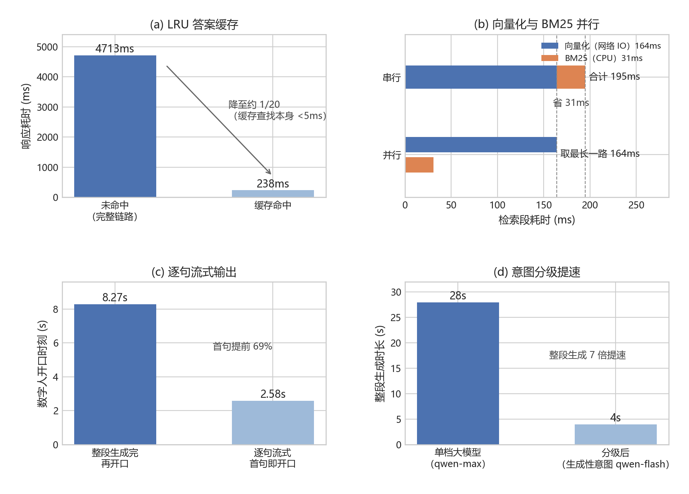
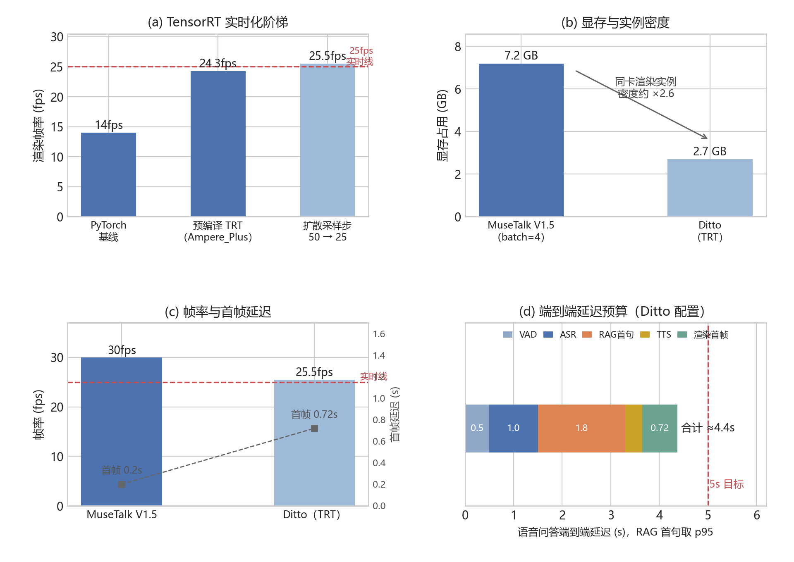
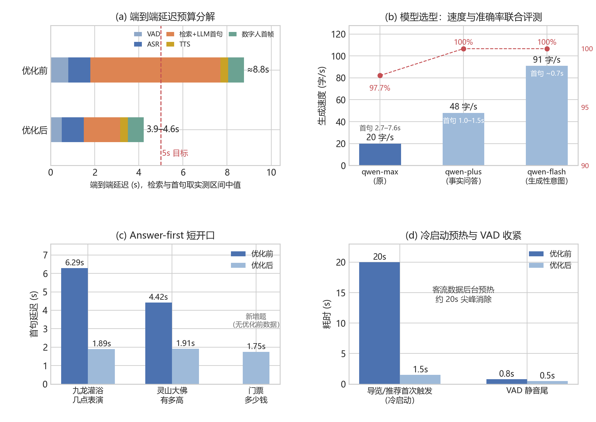
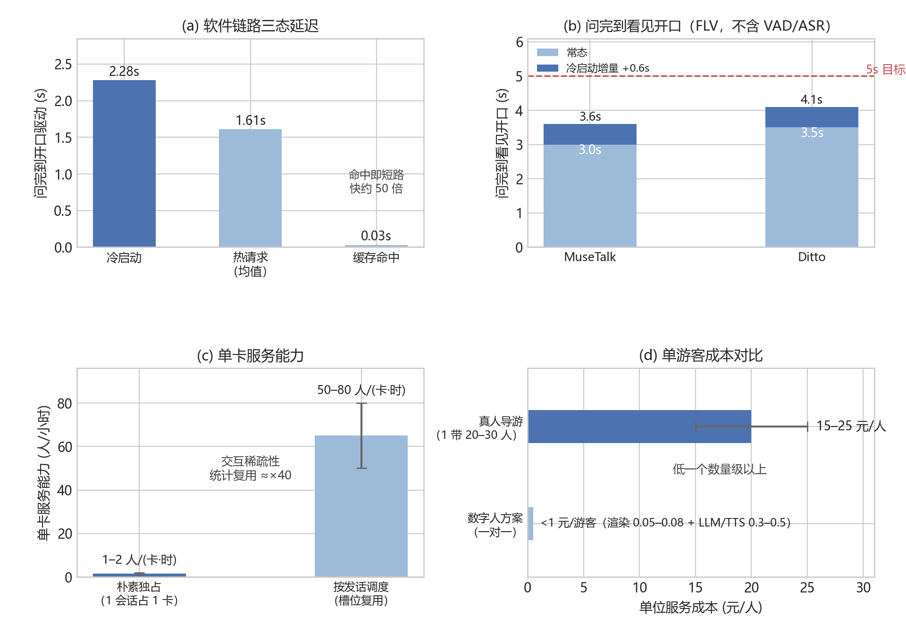

# 算法章增量素材库（供手动改稿选摘）

使用说明：本文档按新版（7-12 修改版）在旧版之上**新增或改写的内容**逐条整理，每条给出插入位置、操作方式与可直接复制的成品文字/表格/插图。文中表号、图号沿用新版编号，你插入自己文档时按实际顺序重编即可。纯体例调整（编号列表改点列、表头加粗等）不在此列，见文末附录。

---

## 素材 1　4.1 开篇：本章导读句（改写）

**位置**：表 4-1 之后的段落。
**操作**：替换原句"准确率是是系统的底线；其余四项决定体验质量与能否投入运营。……"

> 准确率是其中唯一带明确数值的硬性指标，是系统的底线；其余四项决定体验质量与能否投入运营。各节按统一结构展开：问题背景、方案选型（含对比数据）、底层原理、工程实现、实测验证，并各设一节诚实边界，明确每项技术的能力范围，避免夸大。

另：表 4-1 第一行"成果"由"准确率 97.1%"扩为"准确率 97.1%，陷阱拒答纠错 100%"。

---

## 素材 2　4.1.2 生成模型选型（补两句）

**位置**：LLM 选型表前后。
**操作**：表前引语替换为第一句；表后"选型依据在于……"替换为第二句。

> 这是一处经过实测权衡的工程决策，而非随手选型：

> 这一决策的依据在于：在 RAG 架构下，事实正确性由检索保证，大模型只负责组织语言。因此可以为生成模型选择"更快而非最强"的档位，这正是 RAG 将"知识"与"表达"解耦后释放出的优化空间。

另：表中 qwen-plus 行理由补"是压住语音 <5s 的关键"。

---

## 素材 3　4.1.4 真实 chunk 原文节选（新增段落）

**位置**：分块策略两点列之后、"向量化与命名空间隔离"小标题之前。
**操作**：新增整段。

> 以生产库中"佛足坛"的结构化知识块为例，其原文节选为："景区名称: 灵山胜境 | 景点ID: LS-003 | 景点名称: 佛足坛 | 具体位置: 五明桥北侧，菩提大道起点，处于景区中轴线之上…… | 建筑/景观参数: 巨型佛足印一对，左右对称摆放，每只足印长1.2m，宽0.6m，采用整块青铜铸造而成…… | 文化内涵: 复刻佛祖释迦牟尼真身脚印，足心刻有千辐轮相、宝瓶鱼纹等32种吉祥图案……"，全块 771 字。"字段名: 值"的格式使"佛足坛的尺寸是多少"这类问题与"建筑/景观参数: ……长1.2m"在字面与语义两个通道上同时对齐。

---

## 素材 4　4.1.4 库规模实测（句中插入）

**位置**："每个 chunk 经 BGE-M3 编码为 1024 维归一化稠密向量，存入 ChromaDB。"之后。
**操作**：插入一句。

> 以灵山库为例，当前生产库共 113 个知识块（含结构化景点块、叙述性文档块与运营期经管理端补充的 FAQ 问答块），入库时自动抽取出 22 个景点名构成实体表，供检索编排层的实体锚定使用。

---

## 素材 5　4.1.5 两路检索候选实测（新增表 + 前后文）

**位置**：混合检索小节末尾（BM25 公式之后、"重排序"小标题之前）。
**操作**：原句"两路结果去重融合为候选集。语义与关键词互补，是召回率（不漏）的保障。"整体替换为以下内容。

> 以生产环境实测问题"灵山大佛有多高？"为例，两路各自的前三名候选如表 4-4 所示（灵山库 113 块，两路各取 Top-10，此处截取前三；单次实测稠密近邻查询 4.4ms、BM25 全库打分 31.1ms）。

**表 4-4　两路检索前三名候选实测（问题："灵山大佛有多高？"）**

| 排名 | 稠密检索（余弦相似度） | 稀疏检索（BM25） |
|---|---|---|
| 1 | FAQ 块"问：灵山大佛有多高？答：灵山大佛通高88米（佛体79米+莲花瓣9米）……" | 同一 FAQ 块（字面完全命中） |
| 2 | 大佛结构化块"具体位置: 祥符禅寺北侧……景区最高处……核心地标" | "问：景区里有素斋餐厅吗，大概多少钱一位……"（字符碰撞噪声） |
| 3 | 大佛结构化块"演艺/开放信息: ……钟楼定时有钟声表演……" | "问：灵山胜境几点开门，几点关门……"（字符碰撞噪声） |

> 两路第一名同时命中含标准答案的知识块；稀疏路第二、三名是"多少""大"等高频字符碰撞出的噪声，稠密路第二、三名语义相关但不含高度数字。这正是"融合加重排"要处理的典型局面：融合保证正确块进入候选集（不漏），重排把它顶回第一（不乱）。

---

## 素材 6　EA-RAG 机制①实体锚定（段末追加）

**位置**：机制①"……从机制上杜绝'问 A 景点、召回 B 景点'的张冠李戴。"之后。
**操作**：段末追加。

> 生产实测中，"灵山大佛有多高？"从灵山实体表（22 个景点名）匹配到"灵山大佛"，同时"灵山大照壁""灵山梵宫"因公共子串"灵山大""灵山"达到长度门限被弱命中；锚定加成刻意设为 0.02（约为 RRF 第一名分值 1.2 倍），弱命中带来的少量误锚定不足以压过相关性排序，这是加成常数取小的原因。

---

## 素材 7　EA-RAG 机制②自适应融合（整句替换 + 追加）

**位置**：机制②weighted RRF 公式之后的权重说明句。
**操作**：整句替换为以下内容。

> 其中权重按 query 特征动态调整：含数字或量词特征（如"多高""多少""哪年"）时取 w_sparse = 1.4，因精确匹配更可靠；口语化长句（18 字以上）时取 w_dense = 1.3，因语义理解更重要；其余等权。两个实测触发例："灵山大佛有多高？"命中量词特征"多高"，取 w_sparse = 1.4；"灵山大佛比乐山大佛高吗？"无数字量词且不足 18 字，回落等权。以前者为例，含标准答案的 FAQ 块同时居两路第一名，融合分为 1.0/(60+1) + 1.4/(60+1) = 0.0393，再叠加实体锚定 0.02。

---

## 素材 8　EA-RAG 机制③门控（表加两行 + 新增两段）

**位置**：置信度门控阈值标定表（旧表 4-4）。
**操作**：表中在 0.05 与 0.2 之间插入 0.1 行、在 0.2 与 0.5 之间插入 0.3 行：

| 阈值 | 库外题拒答率 | 正常题误拒率 |
|---|---|---|
| 0.05 | 40% | 0% |
| 0.1 | 40% | 0% |
| 0.2（选定工作点） | 60% | 0% |
| 0.3 | 60% | 1% |
| 0.5 | 80% | 1% |

**操作**：表后"选定 0.2 是……"一句扩写为以下整段，并在其后新增诚实边界段。

> 标定的原始分数解释了这条曲线的形状：5 道库外陷阱题的重排 top1 分实测为 0.0065、0.0107、0.1253、0.3891、0.6249，而 105 道正常题的最低 top1 分为 0.2985。阈值 0.2 恰好拦下前三道库外题，又低于全部正常题分数，因此误拒为零；0.3 起越过正常题最低分 0.2985，开始出现 1 题误拒。两道高分陷阱题（0.3891、0.6249）说明部分库外问题与库内内容字面高度相近，单靠检索分无法区分，这正是在门控之外保留 Prompt 层兜底作为第二道防线的原因。选定 0.2 是误拒率为零前提下拒答能力最强的工作点；两层纵深防御在端到端陷阱测试中 15 道全部正确应对。

> 该算法的诚实边界：检索级消融显示，在评测期知识库规模（每景区 18 至 41 个知识块）下，基线召回率已达 100%，候选集近乎覆盖全库，因此机制①与机制②在现有数据上测不出增量收益。三个机制中，门控的收益由上表实验数据支撑；锚定与自适应融合的价值定位为知识库规模化时的鲁棒性预留，当系统推广至城市级知识库（万级知识块、候选占比降至 1% 以下）时，实体先验与查询自适应才成为召回率的关键保障。这一"未测出提升"的结论如实保留，不作夸大。

---

## 素材 9　Query Rewrite（两段整体替换）

**位置**：4.1.5"解决口语模糊指代问题"小节。
**操作**：两段全文替换。

> 游客的真实提问充满口语指代，如"它多高？""这里门票多少？"。这类问题直接用于检索会因缺少主语而召回错误。本系统设置一个轻量改写器：当检测到指代词时，结合最近两轮对话历史用 qwen-flash 把问题改写为完整形式。

> 为控制延迟，改写只在必要时触发：问题命中 11 个指代词构成的固定表（它、这、那、这里、那里、上面、之前、前面、刚才、其、该），或不足 6 字且有对话历史。生产实测一例：上一轮为"请介绍一下灵山大佛"，本轮问"它比乐山大佛高吗？"，改写器输出"灵山大佛比乐山大佛高吗？"，耗时 397ms；不含指代的"灵山大佛有多高？"直接跳过（0ms），不额外消耗一次 API 调用。改写输出超过 100 字或为空时按失败处理，安全回退用原句检索。

---

## 素材 10　多智能体路由的局部验证（句首插入）

**位置**：4.1.5 多智能体路由小节，"规则快筛 / LLM 兜底"两点列之后那段的开头。
**操作**：段首插入一句。

> 一条局部验证：评测集 105 道知识题在逐题明细中的意图字段全部为 qa、零误路由，即这一层的引入没有把任何事实问题错分到非 RAG 链路，准确率不受影响。

---

## 素材 11　拒答纠错率数据修正

**位置**：4.1.5 末尾（四道防线段）。
**操作**：原"拒答纠错率为97%"改为：

> 这四道防线的有效性由本节后段的陷阱测试验证，拒答纠错率为 100%。

（依据：端到端陷阱测试 15 道全部正确应对，15/15 即 100%。）

---

## 素材 12　4.1.6 工程优化：分阶段实测耗时 + 群图（新增）

**位置**：表"RAG 链路工程优化"之后。
**操作**：新增一段 + 一图。

> 并行检索的收益来自各阶段的实测耗时：单次问答中查询向量化 145 至 164ms（DashScope 网络往返为主）、BM25 全库打分 31ms、稠密近邻查询 4.4ms、融合排序 0.5ms。向量化与 BM25 并行后，检索段的总耗时就压到向量化一项的耗时。四项优化的前后对照如图 4-5 所示。

{ width=92% }

**图 4-5　RAG 链路工程优化前后对照（a 缓存命中；b 检索并行化；c 逐句流式；d 意图分级）**

---

## 素材 13　4.1.7 全链路案例（整节替换为生产实测轨迹）

**位置**：4.1.7 全节。
**操作**：原概念性七步案例（"以'它有多高？'为例……首句约 1.5s 即开口……"）整体替换为以下内容。

> 以生产环境（云端部署，2026-07-12）的一次真实请求串起全链路：上一轮对话为"请介绍一下灵山大佛"，本轮提问"它比乐山大佛高吗？"。各阶段的实际输入、实际输出与实测耗时如表 4-7 所示。

**表 4-7　全链路生产实测轨迹（问题："它比乐山大佛高吗？"）**

| 阶段 | 实际输入 | 实际输出（节选） | 耗时 |
|---|---|---|---|
| 意图路由 | 原句 | qa（规则未命中走默认） | 0ms |
| 答案缓存 | 缓存键 adult::auto::原句 | 带历史不读写缓存 | 0ms |
| 查询改写 | 原句加最近两轮历史 | "灵山大佛比乐山大佛高吗？" | 397ms |
| 查询向量化 | 改写后问题 | 1024 维向量（前三维 -0.0539、-0.0028、-0.0442） | 164ms |
| 稠密检索 | 查询向量 | 第一名为 FAQ 块"问：灵山大佛有多高？答：……通高88米……" | 4.4ms |
| BM25 检索 | 改写后问题按字符切分 | 同一 FAQ 块居第二名，第一名为字面碰撞噪声 | 31ms，与向量化并行 |
| 加权 RRF 融合 | 两路排名与实体表 | 等权（改写句无数字量词特征），取前 4 块 | 0.5ms |
| Prompt 组装 | 4 个知识块、意图指令、人格与语言指令 | system prompt 共 2763 字 | 约 0 |
| LLM 生成 | qwen-plus | "[情绪:平静] 灵山大佛比乐山大佛高。灵山大佛通高88米，含莲花座和台基总高101.5米；而乐山大佛通高71米……" | 整段 2968ms |
| 情绪解析 | 情绪标签 | 平静，映射数字人表情条件 | 约 0 |

> 这条轨迹有两处值得说明。其一，回答中灵山侧的事实（88 米、101.5 米）来自检索命中的知识块、可溯源，乐山大佛的 71 米来自大模型通识；跨景区对比不属于事实性测试集范畴，库内事实始终受检索约束。其二，本次从提问到全部说完约 3.6 秒；流式模式下第一句"灵山大佛比乐山大佛高。"一生成完即开口，开口时刻远早于整段完成，评测集实测首句 p95 为 1.8s。

---

## 素材 14　4.1.8 评测方法论四处充实

**位置与操作**：① 测试集自动派生段，句尾补景区题数：

> 实测对 5 景区 46 个景点（灵山 16、西湖、黄山、故宫各 8、拈花湾 6）生成 82 道覆盖题，覆盖率由构造保证 100%；另补 23 道考查叙述性文档的精选难题，正常题库共 105 道，各景区题数为灵山 35、黄山 21、故宫 20、西湖 16、拈花湾 13。

② 评分方式段，句尾追加真实评分记录：

> 一条真实评分记录：考题"灵山大佛的建筑或景观参数（尺寸、规模等）是多少？"由"建筑/景观参数"字段派生，关键词为 88、79、101.5；系统回答首句"灵山大佛高88米。"随后展开"主体高79米，加上9米高的莲花瓣基座……算上台基，整体高度达到101.5米"，三个关键词全部命中，首句 1.43s、整段 5.28s，判定通过且有效。

④ 陷阱集段，句尾追加两条真实应对：

> 两条真实应对：问"灵山大佛的设计师生日是哪天？"，回答为标准兜底话术"这个问题我需要进一步查阅，您可以向工作人员咨询"（首句 1.17s）；问"灵山胜境景区里的肯德基几点关门？"，系统先纠正前提"灵山胜境景区内没有肯德基门店"，再转荐景区内素斋餐厅。

---

## 素材 15　4.1.8 各景区消融分项（新增表 + 分析段）

**位置**："结果分析"段（"关闭检索后准确率为 41.0%……"）之后。
**操作**：原段句尾补一句引表，再新增表与分析段。

> ……因此准确率主要来自检索增强，而非大模型本身。各景区的消融分项（表 4-10）进一步揭示了增益的分布规律。

**表 4-10　各景区准确率与消融分项**

| 景区 | 题数 | 完整RAG | 关闭检索（裸模型） | RAG增益 |
|---|---|---|---|---|
| 灵山胜境 | 35 | 94.3% | 37.1% | +57.2 |
| 拈花湾 | 13 | 100% | 15.4% | +84.6 |
| 西湖 | 16 | 100% | 68.8% | +31.2 |
| 黄山 | 21 | 100% | 33.3% | +66.7 |
| 故宫博物院 | 20 | 95.0% | 50.0% | +45.0 |

> 裸模型分数与景区知名度明显正相关：西湖、故宫这类顶级景区在预训练语料中曝光充分，裸模型也能答对一半以上；拈花湾这类新建小镇景区仅 15.4%。RAG 的增益恰恰在非头部景区上最大，而全国绝大多数景区都属于后者，这从数据上支撑了插拔式知识库面向任意景区推广的定位。

---

## 素材 16　4.1.8 未命中题逐条复核（整句替换）

**位置**：严格口径说明句（"需说明的是，关键词匹配为严格口径……"）。
**操作**：整句替换为：

> 需说明的是，关键词匹配为严格口径。105 题中被判未命中的共 3 题，逐条复核均为口径问题而非事实错误：佛足坛一题答"每只足印长一点二米，宽零点六米"，数字被念成中文，未匹配关键词 1.2 与 0.6；乾清宫一题答"高二十米，建筑面积约一千四百平方米"，同样未匹配 20 与 1400；降魔浮雕一题对关键词"坚守本心、终能成道"做了同义转述（"始终坚定无畏……最终战胜心魔、觉悟成佛"）。因此 97.1% 是偏保守的下界。

---

## 素材 17　4.2 混合分派策略（整段替换）

**位置**：4.2 意图分派"混合分派策略"段。
**操作**：整段替换（新增规则表构成数据）。

> 意图识别如果每次都调用一次大模型，会给最高频的"知识问答"凭空增加约 150ms 延迟。因此采用两级混合策略（流程见图 4-7）：先以关键词规则快筛，规则表覆盖四类非 qa 意图共 64 个关键词（安抚 19、路线 18、推荐 14、闲聊 13），按"安抚优先"的固定顺序匹配（游客求助的信号最强、最不容错过），命中即直接路由，0ms；规则未命中且问题本身模糊（不足 8 字且带上下文，如带指代的短追问）时，才调用一次轻量模型（qwen-flash）兜底分类；其余情况默认归入 qa。这样绝大多数请求走规则、不给主链路增加延迟，且当 LLM 分类失败时安全回退到 qa，不会中断服务。

---

## 素材 18　4.3.4 效果与边界（标题改名 + 段末追加）

**位置**：4.3.4，标题"效果"改为"效果与边界"。
**操作**：段末追加。

> 其诚实边界在于：客流为统计模型估计，并非闸机实时数据；客户端已接入 GPS 与高德地图（含坐标系纠偏与地理围栏）用于地图定位与就近指引，而把 GPS 实时坐标进一步喂入讲解情境、由地理围栏自动触发"走到哪讲到哪"，是正在推进的方向。

---

## 素材 19　4.4.4 诚实边界（新增小节）

**位置**：4.4 视觉定位末尾新增小节。
**操作**：新增全节。

> **4.4.4 诚实边界**
>
> 用户感知到的"AR 体验"约 80% 来自这条"拍照即懂我在哪、给我指路"的链路，工程成本却很低。但必须诚实区分：真 AR（实景叠加 3D 箭头导航）需要 SLAM 或 ARCore 级的空间定位与姿态追踪，是另一个量级的工程量，本系统未实现，列为决赛或赛后的拉伸项。本系统交付的是视觉定位加口语指路，而非实景三维叠加。

---

## 素材 20　4.5 换引擎对照群图（新增）

**位置**：换引擎前后实测对照表之后，"端到端延迟预算……约提升 2.6 倍。"句尾。
**操作**：句尾补一句引图，随后插图。

> ……同一张卡可容纳的渲染实例数约提升 2.6 倍。实时化路径与换引擎前后的关键量化指标如图 4-12 所示。

{ width=92% }

**图 4-12　引擎实时化与换引擎前后对照（a TensorRT 实时化阶梯；b 显存与实例密度；c 帧率与首帧延迟；d 端到端延迟预算）**

---

## 素材 21　4.5 欢迎片当前状态（新增段）

**位置**：含手势欢迎片小节，"在技术演进方向上……"段之前。
**操作**：新增一段。

> 需说明本功能的当前状态与技术边界。前端的欢迎片播放链路与交叉淡出过渡已实现并通过验证：连接时按景区与同行类型查询欢迎片清单，命中则在舞台播放含手势成片（自带音频），播完触发约 480 毫秒淡出回归实时问答；清单为空或未命中时优雅回退到实时数字人开口迎宾。预渲染管线的各环节脚本已具备并在本地验证，含手势成片资产的批量产出与按景区入清单仍在进行中。

---

## 素材 22　4.5 嘴型缩放定稿依据（句尾补）

**位置**："实测在 0.65 档'嘴型更含蓄'"句。
**操作**：句尾补四字：

> ……实测在 0.65 档"嘴型更含蓄"经主观盲评定稿。

---

## 素材 23　4.6 语音链路优化群图（新增）

**位置**："优化后端到端延迟预算"表之后、"评测口径需说明……"段之前。
**操作**：新增一句引文 + 一图。

> 以上四项优化与前后指标的图形化对照如图 4-15 所示。

{ width=92% }

**图 4-15　语音链路延迟优化前后对照（a 端到端预算分解；b 模型选型联合评测；c Answer-first 短开口；d 冷启动预热与 VAD 收紧）**

---

## 素材 24　4.7 并发与成本群图（新增）

**位置**：成本估算段"合计低于 1 元每游客……弹性无限并发。"句尾。
**操作**：句尾补一句引图，随后插图。

> ……且支持一对一、24 小时、多语言与弹性无限并发。延迟与成本的实测对照如图 4-17 所示。

{ width=92% }

**图 4-17　并发与成本实测（a 软件链路三态延迟；b 问完到看见开口；c 单卡服务能力；d 单游客成本对比）**

---

## 素材 25　4.7.8 诚实边界与风险（改名 + 重写为四条）

**位置**：4.7.8，标题"适用范围与改进方向"改为"诚实边界与风险"。
**操作**：原四条编号列表替换为以下四条点列。

> - 当前 GPU 池实测为单槽：完整多 GPU 调度与弹性伸缩属规模化阶段工程，本节已落地的是容量抽象与降级底座，多卡只需调整池大小配置并接入 GPU worker。
> - 缓存命中率是成本的关键变量：景区问题重复率高使命中率乐观，但需上线后用真实热点话题数据持续校准预渲染清单。
> - 降级文字答复的首字延迟：当前降级时返回整段答复（非流式），文字模式的感知延迟接近整答时长，可后续让文字模式直连流式问答进一步压低。
> - HLS（iOS）分段缓冲比 FLV 高 1 至 3 秒，是端到端延迟的变量，需真机校准。

---

## 素材 26　4.8 两处标题措辞

- 4.8.7 标题"补充说明"改为"诚实边界"。
- 4.8.5 内"关于批处理的补充说明"改为"关于批处理的诚实说明"。
- 4.9 对照表标题"算法设计与赛题要求对照"改为"算法设计与赛题红线对照"。

---

## 附录　全文体例调整（不逐条列原文）

1. 新版存在两处旧版重号已理顺：两个"表 4-12"、两个"图 4-1"。你手动改稿时注意自己文档里是否也有同样重号。
2. 全文"韵律"统一改为"语速"（TTS 实际只调语速一个参数，措辞与实现对齐），涉及 4.5 情绪联动与播音神态映射表数处。
3. "数据不出景区"改为"数据不出园区"；"范式"改为"原理/做法"；新增正文不用内联加粗。
4. 多级编号列表（"(1)""1."嵌套）统一改为加粗小标题或点列；表头行加粗；图注统一为图下方加粗独立行。
5. 四张群图对应的绘图脚本在服务器 `/root/autodl-tmp/*_panels.py`，改数据可重渲。
